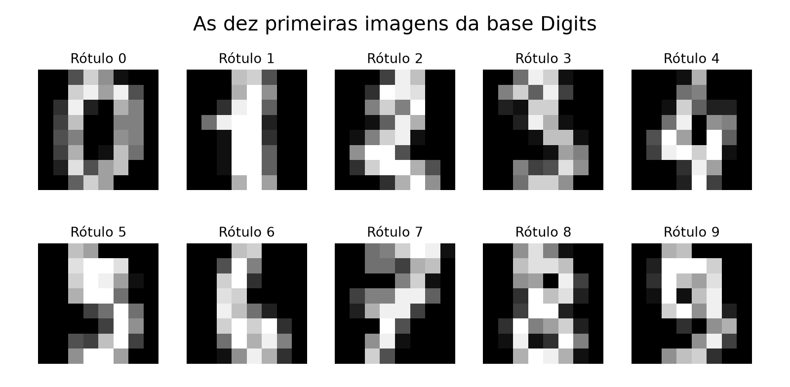

# Reconhecimento de dígitos manuscritos com uma rede neural

Sou Tarcyo Guilherme Maia Borges e desenvolvi este projeto na disciplina de Introdução às Redes Neurais Artificiais, com o professor Thierson Couto Rosa, no Instituto de Informática da UFG.

Quando olho para um número escrito à mão, costumo reconhecê-lo mesmo quando outra pessoa escreve o algarismo de um jeito diferente do meu. **Como ensinar uma rede a reconhecer esse mesmo algarismo?** Para responder, implementei uma rede neural em NumPy e treinei a mesma arquitetura de oito maneiras. Queria descobrir quais escolhas de treinamento faziam diferença na hora de reconhecer um dígito que a rede ainda não tinha visto.

## 🎥 Vídeo e slides

No vídeo, alterno entre os slides e o VS Code. Mostro como uma imagem vira uma entrada da rede, acompanho o treino no código e comparo os resultados das oito configurações.

- [Assistir ao vídeo completo no Google Drive](https://drive.google.com/file/d/14jt_MkyyYS67NnpVrR8EbaJsrRbUcldg/view?usp=drivesdk)
- [Abrir os 24 slides da apresentação em PDF](Reconhecimento%20de%20d%C3%ADgitos%20manuscritos%20-%2024%20slides.pdf)

---

## 🔢 Das imagens às previsões

Usei a base **Digits** do scikit-learn. São 1.797 imagens de algarismos escritos à mão, cada uma acompanhada de um rótulo de 0 a 9. Na figura abaixo, o número acima de cada imagem é o rótulo que veio com a base.



Cada imagem tem apenas **8 × 8 pixels**. Li os 64 valores na ordem das linhas e dividi cada um por 16, a intensidade máxima da base. Assim, cada pixel chega à rede como um número entre 0 e 1.

Separei as imagens em três grupos. Usei a semente 42 e fiz duas divisões estratificadas para manter aproximadamente a mesma proporção de cada algarismo nos três conjuntos.

| Conjunto | Imagens | Como usei |
| --- | ---: | --- |
| Treino | 1.257 | Ajustei os pesos e os vieses da rede a cada minilote. |
| Validação | 270 | Acompanhei os acertos a cada época e comparei as oito configurações. |
| Teste | 270 | Avaliei a configuração escolhida depois de concluir a comparação. |

## 🧠 Como treinei a rede

Usei **64 entradas → 32 neurônios na camada oculta → 10 saídas**. Na camada oculta, apliquei a ReLU. Na saída, cada algarismo recebe uma pontuação. A previsão é o algarismo de maior pontuação.

Durante o treino, usei a softmax para transformar as pontuações em probabilidades. A entropia cruzada leva em conta a probabilidade atribuída ao rótulo correto. Pela retropropagação, calculei os gradientes que o otimizador usa para ajustar os pesos e os vieses.

- **Ponto de partida.** Na rede de referência, usei inicialização He, RMSprop com momentum zero, taxa de aprendizado fixa em 0,001 e regularização L2 de 0,0001.
- **Comparação.** Mantive os mesmos conjuntos de dados, a mesma arquitetura e a mesma ordem dos minilotes. Treinei cada configuração por 20 épocas, com até 32 imagens por minilote.
- **Critério de escolha.** Comparei o número de acertos nas 270 imagens de validação **ao fim da época 20**. Só depois usei o conjunto de teste.

---

## 📊 O que os oito experimentos mostraram

Cada linha mostra a mudança em relação à referência. Os links abrem os históricos com os resultados de cada época.

| Experimento | Acertos na validação (de 270) | Acurácia | Diferença em acertos |
| --- | ---: | ---: | ---: |
| 1. [Referência](resultados/historico_referencia.csv) | 256 | 94,81% | 0 |
| 2. [Inicialização Xavier](resultados/historico_xavier.csv) | 257 | 95,19% | +1 |
| 3. [Taxa fixa de 0,0003](resultados/historico_he_taxa_0_0003.csv) | 246 | 91,11% | −10 |
| 4. [Taxa reduzida à metade após a época 10](resultados/historico_referencia_metade_apos_10.csv) | 254 | 94,07% | −2 |
| 5. [He com momentum 0,9](resultados/historico_referencia_momentum_0_9.csv) | 260 | 96,30% | +4 |
| 6. [Otimizador Adam](resultados/historico_adam.csv) | 256 | 94,81% | 0 |
| 7. [Dropout de 20% no lugar de L2](resultados/historico_referencia_dropout_0_2.csv) | 256 | 94,81% | 0 |
| **8. [Xavier com momentum 0,9](resultados/historico_xavier_momentum_0_9.csv)** | **261** | **96,67%** | **+5** |

**Por que escolhi Xavier com RMSprop e momentum 0,9?** Mantendo He, adicionar momentum já levou a rede de 256 para 260 acertos. Com o mesmo momentum, trocar He por Xavier acrescentou mais um. He chegou a 264 na época 19, mas terminou com 260. Como comparei todos os modelos na época 20, escolhi o que terminou com 261. A diferença entre os dois foi de uma imagem nesta execução.

**E no teste?** Carreguei os pesos que obtive no experimento 8, treinado com Xavier, RMSprop com momentum 0,9, taxa fixa de 0,001 e regularização L2. Usei esses pesos para fazer as previsões nas imagens de teste. A rede acertou **266 das 270 imagens (98,52%)** e errou quatro. Foram cinco acertos a mais do que na validação, em outro conjunto de imagens. [Consultar a avaliação final em CSV](resultados/avaliacao_final.csv)

---

## 💻 Como reproduzir no seu computador

Usei **Python 3.12** e rodei o projeto em CPU. A base Digits já vem com o scikit-learn. Depois de baixar ou clonar o repositório, abra um terminal na pasta deste README.

### 1. Preparar o ambiente

**Windows · PowerShell**

```powershell
py -3.12 -m venv .venv
.\.venv\Scripts\Activate.ps1
```

**Linux ou macOS**

```bash
python3.12 -m venv .venv
source .venv/bin/activate
```

Com o ambiente ativo, instale as dependências.

```shell
python -m pip install -r requirements.txt
```

### 2. Conferir a rede que apresentei no vídeo

Incluí os pesos finais no repositório. Para reproduzir a avaliação, basta preparar a divisão dos dados e carregar os pesos com estes dois comandos.

```shell
python preparar_digits.py
python avaliar_modelo_final.py
```

O primeiro comando cria `digits_preparados.npz`. O segundo lê `pesos_xavier_momentum_0_9.npz`, grava `avaliacao_final.csv` e mostra a seguinte saída no terminal.

```text
validacao: 261/270 (96.67%)
teste: 266/270 (98.52%)
```

Para ver de perto as dez imagens do início, rode `python visualizar_digits.py` e abra `digits_primeiras_10.png`.

### 3. Treinar as oito configurações

Com os dados preparados, execute os comandos na ordem abaixo. O primeiro treino gera a curva de referência. O quinto gera a curva de He com momentum que aparece ao lado da de Xavier no último gráfico. Nos comandos, os decimais são escritos com ponto.

```shell
# 1. Referência
python treinar_referencia.py

# 2. Trocar He por Xavier
python treinar_referencia.py --inicializacao xavier

# 3. Usar taxa fixa de 0,0003 desde a primeira época
python treinar_referencia.py --inicializacao he --taxa 0.0003

# 4. Usar 0,001 nas épocas 1–10 e 0,0005 nas épocas 11–20
python treinar_referencia.py --inicializacao he --taxa 0.001 --reduzir-apos 10

# 5. Adicionar momentum de 0,9 ao RMSprop com He
python treinar_referencia.py --inicializacao he --taxa 0.001 --momentum 0.9

# 6. Trocar RMSprop por Adam
python treinar_referencia.py --otimizador adam --inicializacao he --taxa 0.001

# 7. Substituir L2 por dropout de 20% na camada oculta
python treinar_referencia.py --dropout 0.2

# 8. Combinar Xavier e RMSprop com momentum de 0,9
python treinar_referencia.py --inicializacao xavier --taxa 0.001 --momentum 0.9
```

Ao lado dos scripts, cada treino salva o histórico por época (`historico_*.csv`), a curva de validação (`validacao_*.png`) e os pesos e vieses finais (`pesos_*.npz`). Repetir um treino atualiza os arquivos daquela configuração. Depois do experimento 8, rode `python avaliar_modelo_final.py` novamente para conferir os pesos que você acabou de treinar. Meus históricos originais estão na [pasta de resultados](resultados/).

---

## 🗂️ Onde encontrar cada parte do código

| Arquivo | O que mostro nele |
| --- | --- |
| [visualizar_digits.py](visualizar_digits.py) | Como carrego a base e monto a grade das dez primeiras imagens com seus rótulos. |
| [preparar_digits.py](preparar_digits.py) | Onde normalizo os pixels e separo os índices de treino, validação e teste com `train_test_split`. |
| [treinar_referencia.py](treinar_referencia.py) | Como calculo as pontuações em `propagar`, obtenho os gradientes em `gradientes` e atualizo os parâmetros com RMSprop ou Adam. |
| [avaliar_modelo_final.py](avaliar_modelo_final.py) | Onde carrego os pesos escolhidos e uso `contar_acertos` para conferir as previsões na validação e no teste. |

### Créditos da base

Usei a versão da Digits distribuída com o scikit-learn. A base original, *Optical Recognition of Handwritten Digits*, é de E. Alpaydin e C. Kaynak (1998) e está disponível sob a licença CC BY 4.0. [Base original na UCI](https://doi.org/10.24432/C50P49) · [Licença dos dados](https://creativecommons.org/licenses/by/4.0/) · [Documentação do scikit-learn](https://scikit-learn.org/stable/modules/generated/sklearn.datasets.load_digits.html)
